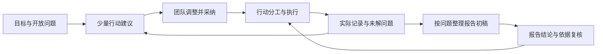

# 3.0首版：全流程的连续性

2026-10-15用户授权开始独立3.0开发，并保留1.0和2.0。全流程首先解决阶段之间的信息断裂，不把实践变成一串必须依次完成的表单。

## 主线

每个实践问题保持稳定标识，行动和记录关联该问题。问题文字可以调整，但已有引用的问题不可直接删除。没有报告也可以开始；只需填主题、目标和至少一个问题，其他条件允许逐步补充。

## 复用与新增

保留2.0的项目保存、并发冲突、材料来源与授权、实践任务与团队讨论、报告原句定位、追问、补证、整篇复查及导出。新增独立`lifecycle`状态、目标问题编辑、行动指导、实际记录、阶段发现与报告桥接。

实践计划不调用已有“结论补证”入口，因为前期尚无待证明结论。指导只围绕开放问题、当前行动和符合处理范围的记录生成。不引入多智能体分工、复杂排期或自动联系对象。

## 可追溯的更新

生成的指导保存输入快照、指纹、方式与时间。输入相关字段变化后，旧建议不可直接采纳。采纳时在同一版本事务中建立任务及关联，重复采纳不重复创建。完成任务不会生成材料，也不会提高支持程度。

实际记录保存为材料，阶段发现是作者自述。记录材料的原文或来源修改后显示需重新核对；移除材料保留问题与备注，但不把失去来源的备注送给AI。未授权或排除材料及其观察备注不进入AI指导上下文。

所有导出使用独立可校验包。新增关系必须完整往返；旧包只读导入为新项目。导入指导不能沿用旧授权直接采纳。

## 已选取舍

首版用可执行的模板和可选AI计划跑通小规模实践。联网查找、更多实践类型、放宽长项目材料容量、阶段发现的逐句语义核对与跨设备协作后置。报告初稿整理已有内容并保留待撰写结论，避免一次生成一篇无来源报告。

下一轮应优先找一项实际实践做小范围试用，观察问题是否足够清楚、记录负担是否合适、建议是否随新发现改变；现阶段不宣称试用效果。
